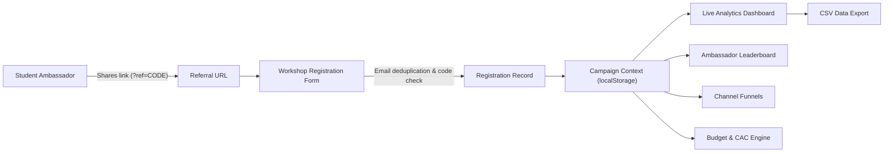

# Project 500 — Campus Growth Tracker

[](https://react.dev/)
[](https://vitejs.dev/)
[](https://recharts.org/)
[](LICENSE)

> **Simulated Growth Marketing Campaign Platform**  
> **Campaign:** *"Build Your First AI Project in 60 Minutes"*  
> **Campaign Goal:** 500 Unique Registrations from Final-Year Engineering Students within 7 Days  
> **Budget Limit:** ₹2,000 Maximum Allocation  

---

## 1. Project Overview

**Project 500 — Campus Growth Tracker** is a React-based growth operations and analytics prototype designed for a simulated NxtWave growth marketing campaign. The campaign promotes a free 60-minute online technical workshop: **"Build Your First AI Project in 60 Minutes"**, targeting final-year engineering students across campuses.

The primary marketing channel is college clubs and student campus ambassadors, supported by WhatsApp developer communities and LinkedIn outreach. With a tight 7-day timeline and a ₹2,000 budget ceiling, the growth team needs granular operational visibility.

This application demonstrates how a modern growth marketer can:
- Track incoming registrations in real-time.
- Attribute registrations reliably to specific referral sources and marketing funnels.
- Monitor student ambassador performance through an interactive leaderboard.
- Analyze daily acquisition velocity against planned trajectory benchmarks.
- Monitor planned allocations versus actual expenditures.
- Make data-informed growth interventions.

> [!NOTE]
> **Simulation Disclaimer:** This software is an educational growth simulation prototype. All student contact details, ambassador records, college distributions, and performance figures are fictional demo data. The application does not send messages to real students or contact external services.

---

## 2. Problem Statement

Growth teams running multi-campus student acquisition sprints face critical attribution and measurement challenges:

1. **Attribution Fragmentation:** Students discover campaigns through varied sources—college tech clubs, campus ambassadors sharing custom links, forwarded WhatsApp broadcast messages, and organic LinkedIn posts. Without structured attribution, it is impossible to identify which channel yields genuine ROI.
2. **Double-Counting Risks:** If a student belongs to a college club and also clicks a WhatsApp link, unprincipled tracking systems double-count the conversion, distorting channel performance metrics.
3. **Ambassador Incentive Disputes:** Campus ambassador programs require auditable referral tracking so top performers receive deserved recognition without relying on self-reported estimates.
4. **Budget Constraints:** With an intensive ₹2,000 budget, marketing teams cannot afford unmonitored spending; every rupee spent on incentives or promotional assets must tie directly to verified signups.

Project 500 solves these challenges with a client-side growth tracking engine featuring single-touch channel attribution, distinct referral-source crediting, live deduplication, and budget governance.

---

## 3. Objectives

- **Track Registrations:** Capture and validate unique student workshop registrations with verified email format and college affiliation.
- **Attribute Registrations:** Accurately link each registration to its discovery channel and attributing ambassador referral code without double-counting.
- **Manage Student Ambassadors:** Provide full roster management, referral code generation, shareable URL creation, and active/inactive status toggles.
- **Monitor Campaign Progress:** Calculate live KPI progress toward the 500-registration goal with velocity trend charts.
- **Compare Marketing Channels:** Measure actual signups against planned channel targets (College Clubs: 250, WhatsApp: 150, LinkedIn: 100).
- **Track Planned vs. Actual Spending:** Monitor the ₹2,000 budget across incentive pools, promotional assets, and contingency reserves with safe cost-per-registration calculations.
- **Export Data for Analysis:** Provide client-side RFC-4180 compliant CSV export for downstream spreadsheet analysis.

---

## 4. Features

Every feature documented below is implemented, verified, and active in the application:

- **Executive Analytics Dashboard:**
  - 5 live KPI cards: Total Unique Registrations, Target Progress (with animated progress bar), Participating Campuses, Active Ambassadors, and Budget Overview (with cost per registration).
  - Dual-axis registration pace chart (daily new registrations vs cumulative progress towards the 500 target benchmark).
  - Channel performance chart comparing actual signups against planned channel targets.
  - Deterministic rule-based growth insights panel generating qualitative observations with small-sample size disclosures.
- **Ambassador Management & Leaderboard:**
  - Complete ambassador roster with name, campus, contact email, referral code, status, attributed signups, and campaign share %.
  - Live competitive leaderboard highlighting top 3 campus ambassadors.
  - One-click referral code and deep-link copying (`?ref=CODE`).
  - Add & edit ambassador modals with automated code generation (`CAMPUS_NAME_##`) and real-time uniqueness validation.
  - Active/Inactive status toggle that preserves historical referral attributions.
- **Registration Management & Deduplication:**
  - Searchable, filterable (by channel and ambassador), and sortable (by date) registration data table with pagination.
  - Add Registration modal with email normalisation and duplicate prevention (rejects already registered emails).
  - Referral code validation: verifies code against known ambassadors before attribution; rejects invalid codes with clear feedback.
  - Clear UI explanation of the distinction between *Discovery Channel* (primary funnel) and *Referral Source* (ambassador credit).
  - URL query parameter prefill: loading `?ref=CODE` automatically opens the registration modal with code and channel pre-populated.
  - Deletion of records with recalculation of all affected ambassador and campaign totals.
- **Bulk CSV Import:**
  - Client-side CSV file upload with automatic column mapping for Name, Email, College, Channel, and Referral Code.
  - Pre-import validation preview displaying valid rows, skipped duplicate emails, and malformed rows.
- **Campaign Channels Governance:**
  - Visual cards for the 3 primary channels showing planned targets, actual signups, percentage achieved, and remaining deficit.
  - Editable channel targets modal with mismatch alert if targets do not sum to the overall 500 target.
- **Budget Tracking & Cost Metrics:**
  - Financial allocation table for Ambassador Incentive Pool (₹1,000), Promotional Materials (₹300), and Contingency Reserve (₹700).
  - Separate recording of actual expenditures.
  - Division-by-zero protected cost-per-registration calculation (displays "Not available yet" when zero registrations exist).
- **Data Persistence & Demo State Management:**
  - Browser `localStorage` persistence under versioned `project500_v1_*` keys.
  - Seeded with 18 realistic fictional student registrations and 6 ambassador profiles across 13 engineering colleges.
  - Demo data reset button in header with confirmation dialog.

---

## 5. Technology Stack

- **Core Framework:** React 18.3.1 (Functional components, custom hooks, React Context API)
- **Build System:** Vite 6.0.0 (Fast HMR, ESBuild bundling)
- **Language:** JavaScript (ESNext, JSX)
- **Data Visualisation:** Recharts 2.15.0 (`ResponsiveContainer`, `ComposedChart`, `BarChart`, `Line`, `Bar`, `XAxis`, `YAxis`, `Tooltip`, `Legend`)
- **Iconography:** Lucide React 0.460.0
- **Design System:** Pure CSS architecture with CSS Custom Properties (`variables.css`, `global.css`, `layout.css`, `components.css`, `pages.css`)
- **Data Persistence:** Browser `localStorage` with versioned keys and structured fallback handlers
- **Export / Import:** Browser-native `Blob`, `URL.createObjectURL`, and RFC-4180 compliant CSV parser/generator

---

## 6. Application Architecture



### Data Flow & Attribution Rules
1. **Primary Acquisition Funnel:** Each registration is assigned exactly one `discoveryChannel` (`college-club`, `whatsapp`, `linkedin`, `other`). The channel breakdown aggregates purely on this field so that `Sum(channel signups) == Total registrations`.
2. **Ambassador Attribution:** If a valid `referralCode` is provided, the record stores `ambassadorId`. The ambassador's attributed count increments and their rank on the leaderboard updates without altering the primary channel count.
3. **Client-Side Persistence:** Application state is managed centrally via `CampaignContext.jsx` and synchronized with browser `localStorage`.
   > [!IMPORTANT]
   > `localStorage` is local to the current browser profile. Multi-user real-time synchronization across devices requires a shared backend database.

---

## 7. Project Structure

```
project-500/
├── index.html                  # HTML entry point with semantic metadata
├── package.json                # Project dependencies and npm scripts
├── package-lock.json           # Locked dependency tree
├── vite.config.js              # Vite configuration
├── .gitignore                  # Git ignore rules for node_modules, dist, logs
├── test-suite.js               # Node.js automated test runner (10 verification scenarios)
├── public/
│   └── favicon.svg             # Application SVG favicon
└── src/
    ├── main.jsx                # React DOM entry point
    ├── App.jsx                 # Root component with state-based routing and ?ref= listener
    ├── context/
    │   └── CampaignContext.jsx # Global React context & state provider
    ├── data/
    │   ├── seedData.js         # 18 fictional student records & 6 ambassador profiles
    │   └── storage.js          # Versioned localStorage CRUD utility
    ├── utils/
    │   ├── idGenerator.js      # Stable UUID generation
    │   ├── referralCodes.js    # Code generation, validation, and shareable URL builder
    │   ├── metrics.js          # Derived calculations (KPIs, pace, channel breakdown, CAC)
    │   ├── insights.js         # Deterministic rule-based performance observations
    │   ├── csvExport.js        # RFC-4180 CSV serializer with UTF-8 BOM
    │   └── csvImport.js        # Bulk CSV file parser, column mapper, and validator
    ├── components/
    │   ├── KPICard.jsx         # Metric card with circular icon and value display
    │   ├── ProgressBar.jsx     # Progress bar with color variants and labels
    │   ├── Modal.jsx           # Accessible dialog overlay with Escape key listener
    │   ├── ConfirmDialog.jsx   # Confirmation modal for destructive actions
    │   ├── EmptyState.jsx      # Placeholder for empty query and list states
    │   ├── SearchBar.jsx       # Search input with clear button
    │   ├── Toast.jsx           # In-app status alerts container
    │   └── Layout/
    │       ├── Sidebar.jsx     # Responsive navigation sidebar & mobile drawer
    │       ├── Header.jsx      # Campaign header with export and reset controls
    │       └── Shell.jsx       # App layout wrapper
    └── pages/
        ├── Overview.jsx        # Primary dashboard (KPIs, Recharts charts, insights)
        ├── Registrations.jsx   # Registrations table, add modal, and CSV importer
        ├── Ambassadors.jsx     # Ambassador directory, modal, and live leaderboard
        ├── Channels.jsx        # Channel funnel performance and target editor
        └── Settings.jsx        # Campaign configuration and financial tracking
```

---

## 8. Prerequisites

- **Node.js:** v18.0.0 or later (verified on Node.js v26.4.0)
- **npm:** v9.0.0 or later (verified on npm v11.17.0)

---

## 9. Installation & Setup

```bash
# 1. Clone the repository
git clone https://github.com/anshu1198/project-500-campus-growth-tracker.git

# 2. Change into the project directory
cd project-500-campus-growth-tracker

# 3. Install dependencies
npm install

# 4. Start the local development server
npm run dev
```

Open `http://localhost:5173` in your browser.

---

## 10. Production Build

To compile production-optimized static assets:

```bash
# Build production bundle into dist/
npm run build

# Preview the production build locally
npm run preview
```

Output assets are generated in `dist/` with gzip compression and cache-busting hashes.

---

## 11. Usage Guide

1. **Dashboard Inspection:** Navigate to **Overview** to review the 5 live KPI cards, pace trend, channel distributions, and growth insights.
2. **Ambassador Creation:** Go to **Ambassadors**, click **Add Ambassador**, enter the student name and campus. A unique code (e.g. `CAMPUS_PRIYA_15`) is generated automatically.
3. **Sharing Referral Links:** Click the link copy button next to an ambassador to copy `https://workshop.nxtwave.in/register?ref=CAMPUS_PRIYA_15`.
4. **Testing Referral Deep-Links:** Paste the URL with `?ref=CAMPUS_PRIYA_15` into your browser. The app navigates to Registrations and opens the form with the code pre-filled.
5. **Registering a Student:** Enter student details. If an existing email is entered, duplicate prevention blocks the submission. If a valid code is entered, credit is attributed to the ambassador.
6. **Importing Data in Bulk:** On the Registrations tab, click **Import CSV**, upload a CSV file with student columns, inspect the preview summary, and commit the import.
7. **Exporting Data:** Click **Export CSV** in the header to download a timestamped CSV of all records.
8. **Resetting Data:** Click **Reset Demo** in the header, review the confirmation prompt, and restore the default simulated dataset.

---

## 12. Data Model & Metrics Definitions

### Data Models
- **Registration Record:** `{ id, name, email, college, discoveryChannel, referralCode, ambassadorId, registeredAt, status }`
- **Ambassador Record:** `{ id, name, college, email, referralCode, status }`
- **Channel Target:** `{ id, name, target }`
- **Budget Entry:** `{ id, category, plannedAmount, actualSpent, notes }`

### Metric Definitions
- **Unique Registrations:** Count of unique student records determined by normalized lowercase email.
- **Target Progress:** `(Total Registrations / Registration Goal) * 100`.
- **Participating Campuses:** Count of distinct normalized college names in the registration records.
- **Cost per Registration:** `Actual Expenditure / Total Registrations`. Shows `"Not available yet"` if total registrations equal 0 to prevent division by zero.
- **Ambassador Campaign Share:** `(Ambassador Attributed Registrations / Total Registrations) * 100`.

---

## 13. Testing Verification

### Automated Test Suite (`test-suite.js`)
An automated verification runner executed 28 assertions across 10 scenarios with 100% pass rate:

```bash
node test-suite.js
```

| Scenario | Tested Assertions | Result |
|---|---|---|
| **1. Initial Launch** | 18 seed records, 6 ambassadors, positive colleges count | **PASS** |
| **2. Ambassador Codes** | Format matching `CAMPUS_NAME_##`, uniqueness enforcement | **PASS** |
| **3. Registration Attribution** | Correct foreign-key linking, channel metrics increment | **PASS** |
| **4. Duplicate Detection** | Normalised case-insensitive email collision rejected | **PASS** |
| **5. Referral URLs** | Clean query string generation (`?ref=CODE`) | **PASS** |
| **6. CSV Escaping** | RFC-4180 escaping for commas, double quotes, and line breaks | **PASS** |
| **7. Invalid Referrals** | Unknown codes return `null` without silent crediting | **PASS** |
| **8. Budget Math** | Planned vs spent arithmetic, zero-division protection | **PASS** |
| **9. Channel Sums** | Channel targets sum validation against campaign target | **PASS** |
| **10. Rule Insights** | Qualitative finding extraction and small-sample disclosure | **PASS** |

### Manual Verification
- Verified responsive layouts on Desktop (1440px), Tablet (768px), and Mobile (375px) with slide-out navigation.
- Verified modal keyboard accessibility (Escape key closing, backdrop click dismissal, focus trap).
- Verified production build output with `npm run build` (0 linting or bundling errors).

---

## 14. Static Deployment Guide

The compiled application in `dist/` can be deployed to any static web host.

### Vercel
```bash
npm install -g vercel
vercel
```
- **Build Command:** `npm run build`
- **Output Directory:** `dist`

### Netlify
1. Run `npm run build`.
2. Upload the `dist/` folder at [app.netlify.com/drop](https://app.netlify.com/drop).
- Or link your GitHub repository with publish directory set to `dist`.

### Cloudflare Pages
1. Connect the GitHub repository in the Cloudflare Dashboard.
2. Select framework preset: **Vite**.
3. Build command: `npm run build`, output directory: `dist`.

---

## 15. Limitations

- **Simulated Dataset:** This is an operational simulation. All metrics and contact information are mock records.
- **Client-Side Persistence:** Data is stored in browser `localStorage`. Clearing browser data resets state to defaults, and data is not shared between different users or devices.
- **Production Requirements:** A production-grade deployment would require a backend (e.g. Node.js/Express or Supabase), a relational database (PostgreSQL), server-side JWT authentication, rate limiting, and transactional email verification.

---

## 16. Future Improvements

- **Relational Backend:** Connect to a PostgreSQL/Supabase database for multi-user synchronization.
- **Role-Based Authentication:** Support Admin, Growth Lead, and Student Ambassador logins.
- **Ambassador Self-Service Portal:** Allow ambassadors to log in, view personal analytics, and track payouts.
- **Automated Webhooks:** Trigger notifications to WhatsApp/Slack when campaign registration milestones (e.g. 100, 250, 500) are achieved.
- **A/B Testing Simulator:** Compare workshop landing page conversion rates across different student cohorts.

---

## 17. Assignment Context

This project was built for the **NxtWave Growth Intern Assignment** to demonstrate growth strategy execution, campaign tracking architecture, student referral mechanics, data-driven optimization, and engineering execution.

---

## 18. Author

- **GitHub:** [@anshu1198](https://github.com/anshu1198)
- **Project Repository:** [project-500-campus-growth-tracker](https://github.com/anshu1198/project-500-campus-growth-tracker)
